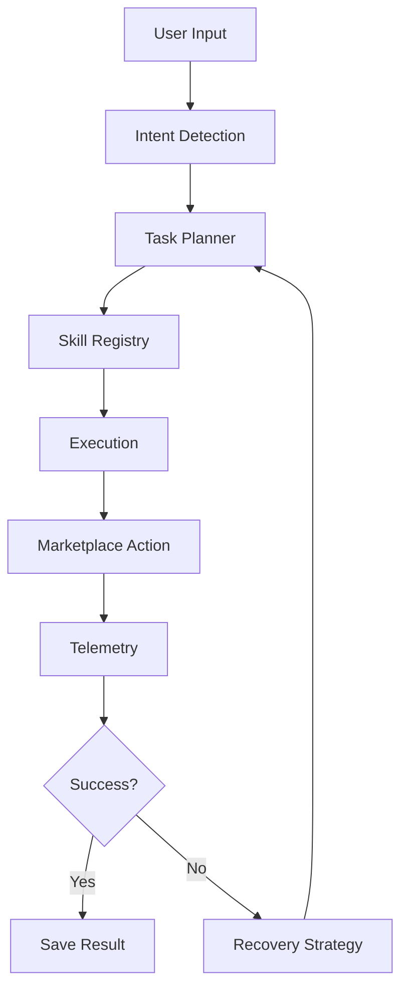

## Agent Workflow


# MarketMind AI


**MarketMind AI** is a Python automation core for marketplace operations: product monitoring, Ozon/Wildberries/Yandex Market parsing, Ozon card generation, table enrichment, task planning, skill-based workflows and telemetry-backed recovery for unstable scraping environments.

It should be presented as an AI-powered marketplace operations engine, not as a simple Telegram bot or a single-purpose parser.

```text
input -> intent -> planner -> skill registry -> execution -> telemetry -> recovery
```

## Core Capabilities

### Marketplace Intelligence

- Ozon parsing/search with Playwright and HTML/API extraction.
- Wildberries parsing through API/basket candidates and cloud fallback.
- Yandex Market parsing through HTML/JSON-LD extraction.
- FunPay offer parsing for gaming/digital goods.
- Product monitoring, price history, alerts and exports.
- Scrape attempt telemetry, block memory and adaptive cooldown logic.

### Ozon Card Generation

- Ozon card drafts from free-form text or URLs.
- Competitor context for SEO and price orientation.
- Optional AI enhancement through the configured AI provider.
- YAML profiles for tone, required attributes and content restrictions.
- JSON/XLSX export for single and batch card workflows.

### Agent-Oriented Workflow

- Natural-language intent routing.
- `StructuredTask` normalization.
- `TaskPlan` generation through a skill registry.
- Skill manifests, dependency graph and execution state model.
- Agent loop: classify, choose strategy, execute, evaluate confidence, fallback and save experience.

### Operations Layer

- Telegram command interface and natural-language routing (35 commands).
- CLI modes for updates, diagnostics, metrics, blocks and enrichment.
- Async SQLAlchemy storage.
- CSV, XLSX, JSON and HTML exports.
- Focused regression tests for parsers, planner, agent loop, cards, exports and Telegram helpers.

## Current State

| Layer | Status | Notes |
|---|---|---|
| Telegram bot, CLI, database, exports | Works | Operational entrypoints and tests exist |
| Ozon/WB/Yandex parsing | Works/usable | Real marketplace scraping depends on network and anti-bot conditions |
| Ozon card generation | Works/usable | Strongest commercial use case |
| Task intent and planner | Prototype/usable | Tested, but still needs product polish |
| Skill manifest graph and execution FSM | Prototype | Strong architecture foundation, not SaaS-ready by itself |
| Recovery/self-healing playbooks | Usable process | Engineering workflow, not magic auto-repair |
| SaaS/API/dashboard | Planned | Needs API, auth, billing, multi-user storage and UI |

## Repository Structure

```text
MarketMind-AI-Core-main/
  app/
    core/                    # enums, errors, base models
    adapters/                # Ozon, WB API adapters
    parsers/                 # Ozon, Wildberries, Yandex Market, FunPay
    universal_parsing_core/  # Generic page classification/extraction
    main.py                  # CLI entrypoint
    bot.py                   # Telegram commands (35 commands)
    task_intents.py          # StructuredTask normalization
    task_planner.py          # TaskPlan and skill registry planning
    agent_loop.py            # Agent classify/strategy/execute/recover loop
    skill_manifest.py        # Skill graph and manifest support
    skill_telemetry.py       # JSONL runtime telemetry
    execution_state.py       # Execution lifecycle states
    database.py              # Async SQLAlchemy models and telemetry
    worker.py                # Background add/update orchestration
    updater.py               # Marketplace update pipeline and retries
    card_filler.py           # Ozon card draft, AI enhancement and exports
    card_profiles.py         # YAML profile loading
    exporter.py              # CSV/XLSX exports
    reporter.py              # HTML report generation
    ai_client.py             # AI provider abstraction
    agent.py                 # AI agent (portfolio analysis, alerts)
    ai_analyzer.py           # Stats, forecast, anomalies
    resilience.py            # Rate limit + circuit breaker
    brd_enricher.py          # BRD XLSX enrichment
    batch_enricher.py        # Batch enrichment
    generic_scraper.py       # Universal scraper
    wb_deals.py              # WB deals and hot offers
    telegram_runtime.py      # Telegram polling lifecycle
    telegram_messages.py     # Message formatting
    telegram_exports.py      # File delivery
    telegram_ai_reports.py   # AI reports
    telegram_card_tasks.py   # Card task builders
    telegram_card_research.py # Competitor research
    telegram_diagnostics.py  # Network/proxy diagnostics
  docs/
    ARCHITECTURE_OVERVIEW.md
    BOT_WORKFLOWS.md
    CODING_STANDARDS.md
    DEMO_SCENARIOS.md
    PROJECT_MAP.md
    ...
  project_skills/
    SKILLPACK.md
    SESSION_UPDATE_PROTOCOL.md
    skills_index.json
    skills_database.md
    skill_manifests/
  profiles/
  tests/
```

## Architecture

MarketMind AI is packaged around an architecture-first story: user input becomes structured intent, the planner selects skills, execution produces marketplace/card/export results, and telemetry feeds recovery decisions.

Full architecture map:

- [Architecture Overview](docs/ARCHITECTURE_OVERVIEW.md)

Mermaid diagrams:

- [Agent workflow](docs/diagrams/agent_workflow.mmd) - input, intent, planner, skills, execution and telemetry loop.
- [Skillpack lifecycle](docs/diagrams/skillpack_lifecycle.mmd) - how local skills are selected, applied, verified and updated.
- [Recovery loop](docs/diagrams/recovery_loop.mmd) - failure handling, fallback decisions and regression-first repair.
- [Marketplace layer](docs/diagrams/marketplace_layer.mmd) - router, marketplace parsers, normalization, exports and resilience.

Commercial packaging docs:

- [Demo Scenarios](docs/DEMO_SCENARIOS.md)
- [Buyer Pitch](docs/BUYER_PITCH.md)
- [Technical Due Diligence](docs/TECHNICAL_DUE_DILIGENCE.md)

## Quick Start

### 1. Configure

```bash
cp .env.example .env
nano .env
```

Minimum required values:

```text
BOT_TOKEN=<telegram bot token>
ADMIN_IDS=<your telegram id>
```

AI features are optional and depend on the configured provider.

Runtime files are controlled by `MARKETMIND_DATA_DIR`. If it is not set, the
app uses `app/data` when that directory is writable; otherwise it falls back to
`/tmp/marketmind`. The same directory is used by default for SQLite, logs,
reports, parser diagnostics, scrape JSONL logs and the persistent Ozon browser
profile. Use `DATABASE_URL`, `LOG_FILE`, `REPORTS_DIR`, `PARSER_DEBUG_DIR`,
`SCRAPE_ATTEMPTS_JSONL`, `BLOCK_PATTERNS_JSONL` or `OZON_PROFILE_DIR` only when
you need to override one specific location.

Optional MCP product source can be enabled for protected marketplaces when a
separate MCP server can fetch product snapshots:

```text
MARKETMIND_MCP_ENABLED=1
MARKETMIND_MCP_COMMAND_JSON=["node","/absolute/path/to/product-mcp-server.js"]
MARKETMIND_MCP_PRODUCT_TOOL=fetch_product
```

The MCP tool should accept `url`, `marketplace` and `task` arguments and return
`name`, `price`, `availability`, `imageUrl`/`image_url` and optional `brand`.
MarketMind treats MCP as an alternative source after Ozon API blocks, not as an
automatic publisher or approval bypass.

### 2. Install

```bash
python3 -m pip install -r requirements.txt
python3 -m playwright install chromium
```

### 3. Run

```bash
# Telegram interface
python3 -m app.main --telegram

# Update tracked products
python3 -m app.main --update

# Recent scrape attempts
python3 -m app.main --metrics 20

# Anti-bot/block memory diagnostics
python3 -m app.main --blocks 20

# Enrich XLSX/CSV table
python3 -m app.main --enrich input.xlsx --out output.xlsx --limit 50
```

### 4. Test

```bash
python3 -m pytest tests/ -v
```

Local tests are designed to avoid real Telegram polling, live marketplace credentials and production tokens. Live marketplace smoke checks should be opt-in and run only against safe targets.

## Dependencies

```
aiogram==3.4.1              # Telegram bot
sqlalchemy==2.0.28          # ORM database
aiosqlite==0.19.0           # Async SQLite driver
aiohttp==3.9.3              # HTTP client
aiohttp-socks==0.8.4        # SOCKS proxy for aiohttp
beautifulsoup4==4.12.3      # HTML parsing
httpx>=0.27.0               # HTTP client (for AI API)
lxml==5.1.0                 # Fast HTML parser
python-dotenv==1.0.1        # .env loading
tenacity==8.2.3             # Retry mechanism
certifi>=2024.2.2           # SSL certificates
playwright==1.42.0          # Browser automation
anthropic>=0.25.0           # Claude API
openpyxl>=3.1.0             # Excel export
pandas>=2.0.0               # Data processing
PyYAML>=6.0.0               # YAML card profiles
fake-useragent>=2.2.0       # Random User-Agent
```

## Main Telegram Workflows

| Command | Purpose |
|---|---|
| `/add` | Add Ozon/WB/Yandex/FunPay URLs to monitoring |
| `/wb` | Add Wildberries product |
| `/update` | Update tracked prices |
| `/list` | List tracked products |
| `/status` | Database statistics |
| `/search` | Search products on Ozon |
| `/compare` | Compare prices across marketplaces |
| `/analyze` | AI portfolio analysis |
| `/deep_analyze` | Deep AI market analysis |
| `/deals` | Best deals (30-day price minimum) |
| `/wb_deals` | WB deals and hot offers |
| `/anomalies` | Price anomaly detection |
| `/forecast` | 7-day price forecast |
| `/alerts` | Active price alerts |
| `/reviews` | AI review analysis |
| `/ozon_card` | Generate one Ozon card |
| `/ozon_batch_cards` | Generate batch of Ozon cards |
| `/card_research` | Competitor research for card |
| `/make_card_last` | Card from last added product |
| `/profile` | Select card generation profile |
| `/export_csv` | Export to CSV |
| `/export_excel` | Export to Excel |
| `/report` | HTML report with charts |
| `/metrics` | Recent scrape attempts |
| `/blocks` | Anti-bot and block memory diagnostics |
| `/health` | Marketplace health status |
| `/net_diag` | Network/proxy diagnostics |
| `/skill_note` | Create skill proposal |
| `/skill_lesson` | Record session lesson |
| `/skill_pending` | Show pending proposals |
| `/skills_graph` | Agent skills Mermaid graph |
| `/subscribe` | Subscribe to price change notifications |
| `/unsubscribe` | Unsubscribe |

## What This Project Is Not

- Not just a WB/Ozon parser.
- Not just a Telegram bot.
- Not a finished SaaS product.
- Not a fully autonomous self-healing AI platform.
- Not a replacement for marketplace Seller API validation.

## Positioning

Use this:

> MarketMind AI is a working marketplace automation core with Ozon card generation, marketplace parsers, exports, telemetry and an agent-oriented skill/planner architecture.

Avoid this:

> A simple Telegram parser bot.

## Production Roadmap

- FastAPI/API layer.
- Multi-user auth and roles.
- Postgres + migrations.
- Queue/scheduler for batch jobs.
- Dashboard for jobs, attempts, blocks and exports.
- Seller API validation for Ozon cards.
- Safe live smoke checks and demo datasets.
- Deployment packaging and product documentation.
