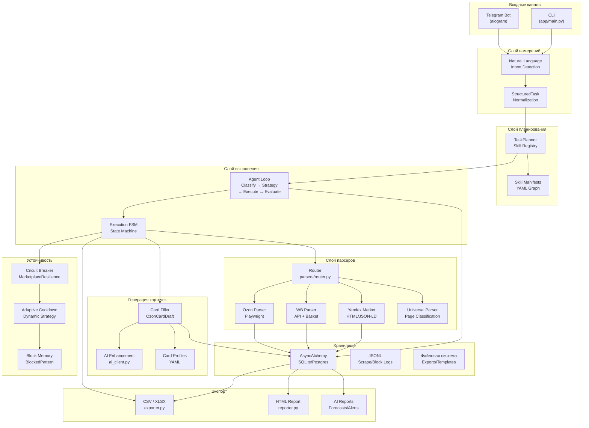
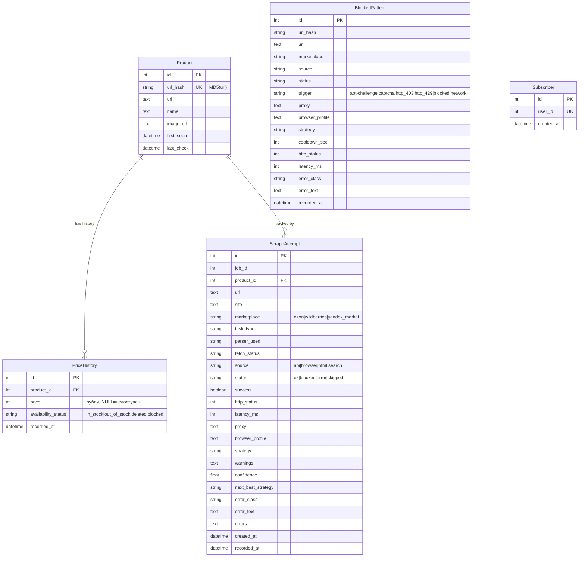
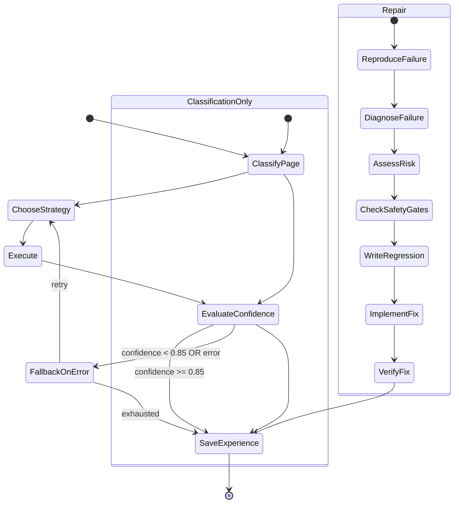

# SPECIFICATION.md — MarketMind AI

> Техническое задание проекта MarketMind AI  
> Версия документа: 1.0  
> Дата создания: 2026-07-09  
> Статус: рабочий (live specification)

---

## 1. Общее описание проекта

### 1.1 Назначение

**MarketMind AI** — Python-ядро автоматизации маркетплейсов. Система предоставляет единый интерфейс (Telegram-бот + CLI) для мониторинга товаров, парсинга цен на Ozon / Wildberries / Yandex Market, генерации карточек товаров для Ozon, экспорта данных и управления аналитикой через агентный workflow.

**Ключевая ценность**: не отдельный парсер и не просто Telegram-бот, а модульная система с архитектурой «намерение → планировщик → навыки → выполнение → телеметрия → восстановление».

### 1.2 Целевая аудитория

| Сегмент | Сценарий использования |
|---|---|
| Малый бизнес / ИП на маркетплейсах | Мониторинг конкурентов, отслеживание цен, генерация карточек |
| Маркетинговые агентства | Пакетная генерка карточек, аналитика по рынку |
| Селлеры-одиночки | Быстрый старт: добавил ссылку — получил уведомление об изменении цены |
| QA / DevOps команды | Диагностика парсинга, метрики попыток, memory anti-bot блокировок |

### 1.3 Ключевые фичи

- **Marketplace Intelligence** — парсинг Ozon (Playwright), WB (API/basket), Yandex Market (HTML/JSON-LD), FunPay
- **Price Monitoring** — история цен, алерты при изменениях, тренд-анализ
- **Ozon Card Generation** — черновик карточки из текста/URL, AI-улучшение, YAML-профили, batch-режим
- **Agent-Oriented Workflow** — детекция намерений, планирование через навыки (skills), FSM-выполнение
- **Resilience** — circuit breaker, адаптивный cooldown, память о блокировках, рекомендация стратегий
- **Export** — CSV, XLSX, HTML-отчёты, AI-отчёты (аналитика, прогнозы, аномалии)

### 1.4 Позиционирование

> MarketMind AI — это рабочее Python-ядро автоматизации маркетплейсов с генерацией карточек Ozon, парсерами маркетплейсов, экспортом, телеметрией и архитектурой навыков/планировщика.

---

## 2. Архитектура

### 2.1 High-Level Diagram



### 2.2 Описание слоёв

| Слой | Файлы | Ответственность |
|---|---|---|
| **Core (Ввод)** | `bot.py`, `main.py` | Приём пользовательского ввода, CLI-команды, FSM |
| **Intent** | `task_intents.py` | Парсинг текста в `StructuredTask`, определение типа задачи |
| **Planner** | `task_planner.py`, `skill_manifest.py` | Построение `TaskPlan`, выбор навыков из реестра |
| **Agent Loop** | `agent_loop.py`, `execution_state.py` | FSM выполнения: classify → strategy → execute → evaluate → fallback → experience |
| **Parsers** | `parsers/router.py`, `parsers/ozon.py`, `parsers/wildberries.py`, `parsers/yandex_market.py`, `parsers/universal.py` | Парсинг маркетплейсов, маршрутизация по URL |
| **Card Generation** | `card_filler.py`, `card_profiles.py`, `ai_client.py` | Генерация черновика карточки Ozon, AI-улучшение, профили |
| **Storage** | `database.py` | Async SQLAlchemy модели, CRUD, телеметрия, health-метрики |
| **Export** | `exporter.py`, `reporter.py`, `telegram_exports.py`, `telegram_ai_reports.py` | CSV/XLSX/HTML экспорты, AI-отчёты |
| **Resilience** | `resilience.py` | Circuit breaker, rate limiting, adaptive cooldown, memory блокировок |

### 2.3 Data Flow

```
Пользователь (Telegram/CLI)
  → Intent Detection (task_intents.py)
    → StructuredTask { type, target_url, fields, confidence }
      → TaskPlanner (task_planner.py)
        → TaskPlan { steps[], skills[], strategy }
          → Agent Loop (agent_loop.py)
            → classify_page → choose_strategy → execute → evaluate → fallback → save_experience
              → Parsers / Card Filler / Export
                → Database (SQLite/Postgres)
                  → Telemetry (scrape_attempts, blocked_patterns)
                    → Resilience (circuit breaker, adaptive cooldown)
```

---

## 3. Доменные модели (БД)

### 3.1 ER-диаграмма



### 3.2 Описание моделей

#### Product (`products`)

| Поле | Тип | Ограничения | Описание |
|---|---|---|---|
| `id` | Integer | PK, autoincrement | Идентификатор товара |
| `url_hash` | String(32) | UNIQUE, NOT NULL, INDEX | MD5-хеш URL товара |
| `url` | Text | NOT NULL | Полный URL товара |
| `name` | Text | — | Название товара |
| `image_url` | Text | — | URL изображения |
| `first_seen` | DateTime | default=UTC now | Дата первого обнаружения |
| `last_check` | DateTime | default=UTC now | Дата последней проверки |

#### PriceHistory (`price_history`)

| Поле | Тип | Ограничения | Описание |
|---|---|---|---|
| `id` | Integer | PK | Идентификатор записи |
| `product_id` | Integer | FK→products.id, CASCADE | Ссылка на товар |
| `price` | Integer | — | Цена в рублях (целое), NULL = недоступен |
| `availability_status` | String(20) | NOT NULL | in_stock / out_of_stock / deleted / blocked |
| `recorded_at` | DateTime | INDEX, default=UTC now | Время записи |

#### ScrapeAttempt (`scrape_attempts`)

| Поле | Тип | Ограничения | Описание |
|---|---|---|---|
| `id` | Integer | PK | ID попытки |
| `job_id` | Integer | default=0 | ID фонового задания |
| `product_id` | Integer | FK→products.id, SET NULL | Товар |
| `url` | Text | NOT NULL | URL запроса |
| `site` | Text | — | Домен |
| `marketplace` | String(32) | NOT NULL | Маркетплейс |
| `task_type` | String(80) | — | Тип задачи |
| `parser_used` | String(120) | — | Использованный парсер |
| `fetch_status` | String(32) | — | Статус получения |
| `source` | String(32) | NOT NULL | api / browser / html / search |
| `status` | String(32) | NOT NULL | ok / blocked / error / skipped |
| `success` | Boolean | — | Успешность |
| `http_status` | Integer | — | HTTP-статус ответа |
| `latency_ms` | Integer | NOT NULL | Задержка в мс |
| `proxy` | Text | — | Использованный прокси |
| `browser_profile` | Text | — | Профиль браузера |
| `strategy` | String(80) | — | Стратегия парсинга |
| `warnings` | Text | — | Предупреждения |
| `confidence` | Float | — | Уверенность результата (0.0–1.0) |
| `next_best_strategy` | String(120) | — | Рекомендуемая следующая стратегия |
| `error_class` | String(120) | — | Класс ошибки |
| `error_text` | Text | — | Текст ошибки |
| `errors` | Text | — | JSON-массив ошибок |
| `created_at` | DateTime | — | Время создания |
| `recorded_at` | DateTime | INDEX | Время записи |

**Индексы:**
- `ix_scrape_attempts_marketplace_recorded` — (marketplace, recorded_at)
- `ix_scrape_attempts_product_id` — (product_id)

#### BlockedPattern (`blocked_patterns`)

| Поле | Тип | Ограничения | Описание |
|---|---|---|---|
| `id` | Integer | PK | ID записи |
| `url_hash` | String(32) | INDEX | Хеш URL |
| `url` | Text | — | URL |
| `marketplace` | String(32) | NOT NULL, INDEX | Маркетплейс |
| `source` | String(32) | NOT NULL | Источник запроса |
| `status` | String(32) | NOT NULL | Статус |
| `trigger` | String(80) | NOT NULL | Триггер блокировки |
| `proxy` | Text | — | Прокси |
| `browser_profile` | Text | — | Профиль браузера |
| `strategy` | String(80) | — | Стратегия |
| `cooldown_sec` | Integer | default=0 | Cooldown в секундах |
| `http_status` | Integer | — | HTTP-статус |
| `latency_ms` | Integer | default=0 | Задержка |
| `error_class` | String(120) | — | Класс ошибки |
| `error_text` | Text | — | Текст ошибки |
| `recorded_at` | DateTime | INDEX | Время записи |

**Индексы:**
- `ix_blocked_patterns_marketplace_recorded` — (marketplace, recorded_at)
- `ix_blocked_patterns_trigger_recorded` — (trigger, recorded_at)

#### Subscriber (`subscribers`)

| Поле | Тип | Ограничения | Описание |
|---|---|---|---|
| `id` | Integer | PK | ID |
| `user_id` | Integer | UNIQUE, NOT NULL, INDEX | Telegram user ID |
| `created_at` | DateTime | default=UTC now | Дата подписки |

---

## 4. API

### 4.1 Текущие CLI команды

| Команда | Описание |
|---|---|
| `py -3.11 -m app.main --telegram` | Запуск Telegram-бота |
| `py -3.11 -m app.main --update` | Обновление отслеживаемых товаров |
| `py -3.11 -m app.main --metrics N` | Последние N попыток парсинга |
| `py -3.11 -m app.main --blocks N` | Диагностика anti-bot блокировок за N минут |
| `py -3.11 -m app.main --enrich input.xlsx --out output.xlsx --limit N` | Обогащение таблицы данными |

### 4.2 Telegram команды

| Команда | Описание | FSM State |
|---|---|---|
| `/start`, `/help` | Справка по командам | — |
| `/add` | Добавить товары по URL для мониторинга | `waiting_urls` |
| `/update` | Обновить цены всех отслеживаемых товаров | — |
| `/list` | Список отслеживаемых товаров | — |
| `/status` | Статистика базы данных | — |
| `/metrics` | Последние попытки парсинга | — |
| `/blocks` | Anti-bot и block memory диагностика | — |
| `/health` | Состояние маркетплейсов (health-score, cooldown) | — |
| `/search` | Поиск товара по названию (Ozon) | `waiting_search` → `waiting_search_results` |
| `/compare` | Сравнение цен по URL | `waiting_compare` |
| `/wb` | Быстрое добавление товаров Wildberries | `waiting_urls` |
| `/wb_deals` | Лучшие сделки на Wildberries | — |
| `/reviews` | Отзывы о товаре | `waiting_reviews` |
| `/ozon_card` | Генерация одной карточки Ozon | `waiting_ozon_card` |
| `/ozon_batch_cards` | Пакетная генерация карточек Ozon | `waiting_ozon_batch` |
| `/card_research` | Исследование конкурентов для карточки | `waiting_card_research` |
| `/make_card_last` | Создать карточку для последнего товара | — |
| `/profile` | Выбор профиля генерации карточек | — |
| `/analyze` | AI-анализ цен | — |
| `/deals` | Лучшие сделки (AI) | — |
| `/anomalies` | Аномалии цен (AI) | — |
| `/deep_analyze` | Глубокий AI-анализ | — |
| `/forecast` | Прогноз цен (AI) | — |
| `/alerts` | Алерты по ценам (AI) | — |
| `/report` | Генерация HTML-отчёта | — |
| `/export_csv` | Экспорт в CSV | — |
| `/export_excel` | Экспорт в XLSX | — |
| `/subscribe` | Подписка на уведомления | — |
| `/unsubscribe` | Отписка от уведомлений | — |
| `/net_diag` | Диагностика сети/proxy | — |
| `/skill_note` | Заметка по навыку | — |
| `/skill_pending` | Ожидающие предложения навыков | — |
| `/skill_lesson` | Урок для skillpack | — |
| `/skills_graph` | Граф навыков (Mermaid) | — |

### 4.3 Планируемый FastAPI

| Эндпоинт | Метод | Описание |
|---|---|---|
| `/api/tasks` | POST | Создание задачи парсинга |
| `/api/tasks/{id}` | GET | Статус задачи |
| `/api/products` | GET | Список товаров |
| `/api/products/{id}/history` | GET | История цен |
| `/api/export/{format}` | GET | Экспорт данных (csv/xlsx/json) |
| `/api/health` | GET | Health-метрики маркетплейсов |
| `/api/cards/generate` | POST | Генерация карточки Ozon |
| `/api/alerts` | GET | Текущие алерты |

---

## 5. Парсеры

### 5.1 Router (`app/parsers/router.py`)

Центральный маршрутизатор, определяющий парсер по URL:

| URL-паттерн | Парсер | Метод |
|---|---|---|
| `ozon.ru` | `OzonParser` | Playwright (ninja-режим) |
| `wildberries.ru`, `wb.ru` | `WildberriesParser` | API + basket candidates |
| `market.yandex.ru` / `market.yandex.ua` | `YandexMarketParser` | HTML / JSON-LD |
| прочие | `UniversalParser` | Page classification |

**Интерфейс парсера:** `BaseParser.can_handle(url) → bool`, `BaseParser.fetch_product(url) → ProductData`

**Единый возврат:** `ProductData` (name, price, availability, url, image_url, raw_snapshot)

### 5.2 Ozon Parser

- Технология: Playwright headless Chromium, ninja-режим (stealth)
- Жизненный цикл: `parser.start()` → `parser.fetch_product(url)` → `parser.stop()`
- Извлечение: HTML + JSON-LD + API-эндпоинты
- Особенности: требует `playwright install chromium`

### 5.3 Wildberries Parser

- Технология: прямые API-вызовы + basket candidate fallback
- Cloud fallback: `cloud_wb_function.py` (серверная функция)
- Без браузера — быстрее Ozon
- Поиск: `parser.search(query, max_per_site)` — параллельно с другими источниками

### 5.4 Yandex Market Parser

- Технология: HTTP-запрос → HTML-парсинг + JSON-LD микроданные
- Определение URL: `is_yandex_market_url(url)`
- Поддержка: market.yandex.ru, market.yandex.ua

### 5.5 Universal Parser

- Классификация страниц: `catalog`, `single`, `article`, `empty`, `unknown`, `mixed`, `unknown_js`
- Извлечение: структурный анализ DOM, повторяющиеся карточки, пагинация
- Модули: `universal_parsing_core/parsers/universal_html.py`, `schemas/page_structure.py`

### 5.6 Resilience (app/resilience.py)

#### Circuit Breaker (`MarketplaceResilience`)

| Метод | Описание |
|---|---|
| `wait_rate_limit(marketplace)` | Ожидание rate limit (случайный jitter) |
| `mark_success(marketplace)` | Сброс счётчика блокировок |
| `mark_block(marketplace)` | Увеличение счётчика, расчёт cooldown |
| `is_open(marketplace)` | Проверка: circuit breaker открыт? |
| `cooldown_remaining(marketplace)` | Оставшееся время cooldown |

#### Adaptive Cooldown (`database.py`)

- Конфигурируемые шаги: `ADAPTIVE_COOLDOWN_STEPS` (по умолчанию `1:300,2:1800,3:7200`)
- Экспоненциальный рост при превышении максимального шага
- Максимальный cooldown: `ADAPTIVE_MAX_COOLDOWN_SEC` (по умолчанию 21600 = 6ч)

#### Marketplace Health (`database.py:get_marketplace_health`)

| Метрика | Формула |
|---|---|
| `heat_score` | block_rate×0.55 + browser_block_rate×0.2 + network_rate×0.15 + normalized_blocks×0.1 |
| `source_scores` | success_rate×0.65 + (1-block_rate)×0.25 + bias - heat_score×0.2 |
| `predictive_blocking` | heat_score ≥ 0.9 |
| `disable_api` | api_blocks ≥ threshold |
| `avoid_browser` | heat_score ≥ threshold OR browser_failures ≥ threshold |

#### Strategy Recommendation (`database.py:recommend_scrape_strategy`)

| Стратегия | Условие | Действие |
|---|---|---|
| `defer_same_url` | URL недавно заблокирован | skip=True, cooldown |
| `api_only_browser_cooldown` | ≥3 browser failures/blocks | skip_browser=True |
| `network_cooldown` | ≥3 network failures | skip=True, wait |
| `self_heal_disable_api` | ≥3 API blocks | skip_api=True |
| `predictive_heat_cooldown` | heat_score ≥ 0.9 | skip_browser=True |
| `normal` | — | full access |

---

## 6. Генерация карточек Ozon

### 6.1 Pipeline

```
Пользовательский ввод (текст / URL)
  → build_ozon_card_draft(task)
    → парсинг: название, бренд, категория, цена, размеры, вес, атрибуты
    → _build_title(), _build_description(), _build_keywords()
  → apply_card_profile(draft, profile)
    → тон, обязательные атрибуты, ограничения контента
  → _apply_competitor_context(draft, competitors)
    → SEO-контекст, ценовая ориентация
  → AI Enhancement (если доступен ai_client)
    → ask_ai() — улучшение заголовка, описания, атрибутов, заметок
  → OzonCardDraft
    → Экспорт: JSON / XLSX
```

### 6.2 OzonCardDraft

| Поле | Тип | Описание |
|---|---|---|
| `offer_id` | str | Автогенерированный ID |
| `name` | str | Заголовок карточки |
| `description` | str | Описание |
| `category_hint` | str | Подсказка категории |
| `brand` | str | Бренд (по умолчанию "Нет бренда") |
| `price` | int | Цена в рублях |
| `old_price` | int | Старая цена (×1.25) |
| `vat` | str | НДС (по умолчанию "0") |
| `weight_g` | int | Вес в граммах |
| `width_mm`, `height_mm`, `depth_mm` | int | Размеры в мм |
| `images` | list[str] | URL изображений |
| `attributes` | dict[str,str] | Доп. атрибуты |
| `keywords` | list[str] | Ключевые слова |
| `checklist` | list[str] | Чеклист перед публикацией |
| `ai_notes` | str | Заметки от AI |
| `competitor_summary` | str | Конкурентный контекст |
| `selling_points` | list[str] | Точки продаж |
| `source_text` | str | Исходный текст |

### 6.3 YAML Profiles (`profiles/*.yaml`)

Профили определяют:
- Тон описания (формальный / маркетинговый / технический)
- Обязательные атрибуты
- Ограничения контента (запрещённые слова, макс. длина)
- Приоритет SEO-ключевых слов

### 6.4 AI Enhancement

- Модуль: `app/ai_client.py`
- Функция: `ask_ai(prompt) → str`
- Доступность: `ai_is_available() → bool` (опционально, зависит от провайдера)
- Улучшает: заголовок, описание, атрибуты, ключевые слова, заметки

### 6.5 Batch Mode

- Вход: список URL/текстов (до 30 штук, `MAX_BATCH_CARD_SOURCES`)
- Обработка: последовательная с сообщением прогресса каждые 5 товаров; поиск Яндекса — для первых 3 товаров пачки
- Результат: `OzonCardBatchItem` { draft, source, status, message }
- Экспорт: JSON / XLSX

---

## 7. Агентный цикл

### 7.1 Intent Detection (`task_intents.py`)

**`detect_task_intent(text, context?) → StructuredTask`**

| TaskType | Описание | Ключевые слова/триггеры |
|---|---|---|
| `SCRAPING` | Парсинг страницы | URL + «парси», «достань данные» |
| `MARKETPLACE_SEARCH` | Поиск товара | «найди», «поищи» + название |
| `CARD_GENERATION` | Генерация карточки Ozon | «карточка», «ozon card» |
| `ADD_URLS` | Добавление URL | URL-ы маркетплейсов |
| `UPDATE` | Обновление цен | «обнови», «цены» |
| `ANALYTICS` | Аналитика | «анализ», «статистика» |
| `BATCH` | Пакетная задача | Несколько URL/задач |
| `REPAIR` | Исправление ошибки | «почини», «исправь» |
| `PAGE_CLASSIFICATION_TRAINING` | Классификация страницы | «классифицируй страницу» |
| `STATUS` | Статус системы | «статус» |
| `LIST` | Список товаров | «список» |
| `UNKNOWN` | Не определено | — |

### 7.2 StructuredTask

```python
@dataclass
class StructuredTask:
    type: TaskType
    raw_text: str
    target_url: str | None
    target_urls: list[str]
    query: str | None
    fields: list[str]  # требуемые поля
    output: str | None  # формат вывода
    requirements: list[str]  # дополнительные требования
    parameters: dict  # произвольные параметры
    payload: str | list[str] | None
    confidence: float  # 0.0–1.0
    plan: list[str]  # шаги плана
```

### 7.3 Task Planner

- Модуль: `app/task_planner.py`
- Реестр навыков: `project_skills/skills_index.json`
- Генерирует `TaskPlan` на основе `StructuredTask`
- Определяет: какие навыки доступны, какие отсутствуют

### 7.4 Agent Loop FSM



#### Стадии агентного цикла

| Stage | Действие | Описание |
|---|---|---|
| `CLASSIFY_PAGE` | `detect_page_structure_before_parsing` | Определение типа страницы |
| `CHOOSE_STRATEGY` | `strategy_for_task()` | Выбор стратегии по типу задачи |
| `EXECUTE` | `executor_action_for()` | Выполнение задачи |
| `EVALUATE_CONFIDENCE` | `evaluate_result_confidence` | Оценка качества результата |
| `FALLBACK_ON_ERROR` | `fallback_if_error_or_low_confidence` | Резервная стратегия |
| `SAVE_EXPERIENCE` | `save_execution_experience` | Сохранение опыта |

#### Стратегии

| Стратегия | Применение | Fallback |
|---|---|---|
| `classify_then_scrape` | Scraping (одна страница) | retry_with_browser_or_structured_source |
| `catalog_paginated_scraping` | Scraping (каталог) | retry_first_page_then_detail_fallback |
| `marketplace_search` | Поиск товара | ask_for_more_specific_product_query |
| `marketplace_url_monitoring` | Добавление URL | retry_with_marketplace_router |
| `regression_first_repair` | Исправление ошибок | capture_failure_signal_and_request_missing_repro |
| `classification_only` | Классификация страницы | — |

### 7.5 Skill Manifests

- Файл: `app/skill_manifest.py`
- Качество навыков: `SkillQuality` { reliability, speed, reuse, complexity, cost, token_usage, risk, success_rate }
- Политики скоринга: `balanced`, `fast`, `cheap`, `stable`, `production_safe`
- Визуализация: Mermaid-граф зависимостей навыков

---

## 8. Telegram бот

### 8.1 Архитектура

- Библиотека: `aiogram` v3
- Хранилище состояний: `MemoryStorage` (FSM)
- Диспетчер: `dp = Dispatcher(storage=MemoryStorage())`
- Доступ: фильтр `ADMIN_IDS` (пустой список = доступен всем)

### 8.2 FSM States

| State | Ожидаемый ввод | Обработчик |
|---|---|---|
| `waiting_urls` | URL-ы товаров | Добавление в мониторинг |
| `waiting_search` | Название товара | Поиск на Ozon |
| `waiting_search_results` | Выбор из результатов | Отображение карточки |
| `waiting_compare` | URL для сравнения | Сравнение цен |
| `waiting_reviews` | URL товара | Отображение отзывов |
| `waiting_ozon_card` | Описание карточки | Генерация черновика |
| `waiting_ozon_batch` | Список описаний | Пакетная генерация |
| `waiting_card_research` | Текст для анализа | Исследование конкурентов |

### 8.3 Natural Language Routing

Бот поддерживает свободный текст — `detect_task_intent()` определяет тип задачи и маршрутизирует:

```
"найди держатель для телефона на ozon" → MARKETPLACE_SEARCH
"https://ozon.ru/product/..." → ADD_URLS / SCRAPING
"сделай карточку для无线耳机" → CARD_GENERATION
"обнови цены" → UPDATE
"что-то сломалось с парсингом" → REPAIR
```

### 8.4 Контекстные сессии

```python
CHAT_PROFILES: dict[int, str]  # chat_id → имя профиля
CHAT_CONTEXTS: dict[int, ContextSession]  # chat_id → контекст
```

`ContextSession` хранит:
- `current_task` — текущая задача
- `last_failure` — последняя ошибка (для repair)
- `active_intent` — текущее намерение
- `status` — статус контекста

---

## 9. Экспорт и отчёты

### 9.1 CSV/XLSX Export

| Формат | Модуль | Описание |
|---|---|---|
| CSV | `app/exporter.py` | Экспорт списка товаров с ценами |
| XLSX | `app/exporter.py`, `app/card_filler.py` | Экспорт с форматированием, стилями |

### 9.2 HTML Report

| Компонент | Файлы |
|---|---|
| Генерация | `app/reporter.py` |
| Шаблон | `templates/report_template.html` |
| Отправка | `app/telegram_exports.py:send_html_report()` |

### 9.3 AI Reports

| Тип | Модуль | Описание |
|---|---|---|
| Market Overview | `telegram_ai_reports.py:build_market_overview_message()` | Обзор рынка |
| Price Alerts | `telegram_ai_reports.py:build_price_alerts_message()` | Алерты по ценам |
| Price Forecast | `telegram_ai_reports.py:build_price_forecast_message()` | Прогноз цен |

### 9.4 Batch Enrichment

| Модуль | Описание |
|---|---|
| `app/batch_enricher.py` | Пакетное обогащение таблиц |
| `app/brd_enricher.py` | Обогащение БРД данных |

---

## 10. Требования

### 10.1 Non-Functional Requirements

| Требование | Значение |
|---|---|
| Python | ≥ 3.11 |
| База данных | SQLite (текущее), Postgres (план) |
| Асинхронность | asyncio + AsyncAlchemy |
| Браузер | Playwright Chromium (для Ozon) |
| Память | ≤ 512MB (без браузера), ≤ 2GB (с Playwright) |
| Тесты | unittest, покрытие: parsers, planner, agent_loop, cards, exports, bot |
| Безопасность | Нет продакшн-токенов в коде, .env для секретов |

### 10.2 Зависимости

| Пакет | Назначение |
|---|---|
| `aiogram` | Telegram-бот |
| `sqlalchemy[asyncio]` | Асинхронный ORM |
| `aiosqlite` | Async SQLite |
| `playwright` | Браузерный парсинг (Ozon) |
| `openpyxl` | XLSX-экспорт |
| `pyyaml` | YAML-профили |
| `aiohttp` | HTTP-запросы (WB, Yandex Market) |

### 10.3 Совместимость

| Платформа | Статус |
|---|---|
| Windows 10/11 | Рабочая (основная платформа разработки) |
| Linux | Рабочая (серверный деплой) |
| macOS | Требуется тестирование |
| Docker | Планируется |

---

## 11. Дорожная карта

### Phase 1: Stabilization (Q3 2026)

- [ ] Завершить миграцию на `ProductSnapshot` (единый формат ответа парсеров)
- [ ] Добавить таблицы `scrape_jobs` и `scrape_attempts` (расширенные)
- [ ] Structured logging: `job_id`, `marketplace`, `url_hash`, `fetch_status`
- [ ] Тесты для всех парсеров (live smoke checks opt-in)
- [ ] Документация API для разработчиков

### Phase 2: API & Auth (Q4 2026)

- [ ] FastAPI-слой: задачи, товары, история, экспорты, health
- [ ] Multi-user auth (JWT + roles)
- [ ] PostgreSQL + Alembic миграции
- [ ] Очередь задач (Celery + Redis или ARQ)
- [ ] Web-панель для мониторинга задач

### Phase 3: Intelligence (Q1 2027)

- [ ] Prometheus метрики: requests_total, blocked_total, latency_histogram
- [ ] Browser pool (Playwright contexts) + proxy rotation
- [ ] Self-healing selectors (LLM-assisted)
- [ ] Seller API валидация для Ozon карточек
- [ ] AI-driven dynamic pricing recommendations

### Phase 4: Scale (Q2 2027)

- [ ] Redis cache / distributed locks
- [ ] Multi-region deployment
- [ ] Dashboard: jobs, attempts, blocks, exports
- [ ] Marketplace expansions: AliExpress, Kufar, Beru
- [ ] White-label для агентств

---

## 12. Требования к коду

### 12.1 Style

- Python 3.11+ с использованием modern features (match/case, type hints, slots)
- Форматирование: `ruff format`
- Линтинг: `ruff check`
- Типизация: `pyright` (рекомендуется)
- Все модели данных: `@dataclass(slots=True)` или Pydantic
- Строки: double quotes для строк, single quotes для ключей dict
- Асинхронность: все I/O-операции через `async/await`
- Документирование: Google-style docstrings (только для публичных API)

### 12.2 Testing

- Фреймворк: `unittest` (текущий), возможен переход на `pytest`
- Запуск: `python -m unittest discover -s tests -v`
- Избегание: live Telegram polling, продакшн-токены, реальные marketplace credentials
- Live smoke checks: опциональные, against safe targets only
- Целевое покрытие: parsers, planner, agent_loop, cards, exports, bot helpers

### 12.3 Security

| Правило | Описание |
|---|---|
| Секреты в .env | `BOT_TOKEN`, `ADMIN_IDS`, `AI_API_KEY` — только в `.env` |
| Нет hardcoded tokens | Все API-ключи через переменные окружения |
| Валидация URL | `is_supported_marketplace_url()` перед парсингом |
| Лимиты | `MAX_NATURAL_TASKS=300`, `MAX_BATCH_CARD_SOURCES=30` |
| Access control | `ADMIN_IDS` фильтр для Telegram-команд |
| XSS protection | `html.escape()` при выводе пользовательского контента |
| SQL injection | SQLAlchemy ORM, параметризованные запросы |

### 12.4 Структура проекта

```
MarketMind-AI-Core-main/
├── app/
│   ├── main.py                 # CLI entrypoint
│   ├── bot.py                  # Telegram commands + NL routing
│   ├── task_intents.py         # StructuredTask normalization
│   ├── task_planner.py         # TaskPlan + skill registry
│   ├── agent_loop.py           # Agent FSM
│   ├── skill_manifest.py       # Skill graph + manifests
│   ├── execution_state.py      # Execution lifecycle
│   ├── database.py             # Async SQLAlchemy models
│   ├── worker.py               # Background orchestration
│   ├── updater.py              # Update pipeline
│   ├── card_filler.py          # Ozon card draft + AI
│   ├── card_profiles.py        # YAML profiles
│   ├── exporter.py             # CSV/XLSX
│   ├── reporter.py             # HTML reports
│   ├── resilience.py           # Circuit breaker + cooldown
│   ├── ai_client.py            # AI provider client
│   ├── searcher.py             # Ozon search
│   ├── agent.py                # PriceAgent
│   ├── generic_scraper.py      # Generic HTML fetcher
│   ├── batch_enricher.py       # Batch table enrichment
│   ├── brd_enricher.py         # BRD enrichment
│   ├── telegram_*.py           # Telegram-specific modules
│   ├── parsers/
│   │   ├── router.py           # Marketplace router
│   │   ├── base.py             # BaseParser + ProductData
│   │   ├── ozon.py             # Ozon (Playwright)
│   │   ├── wildberries.py      # WB (API/basket)
│   │   ├── yandex_market.py    # Yandex Market (HTML)
│   │   ├── universal.py        # Universal parser
│   │   └── funpay.py           # FunPay parser
│   ├── universal_parsing_core/
│   │   ├── parsers/
│   │   │   └── universal_html.py
│   │   └── schemas/
│   │       └── page_structure.py
│   ├── core/
│   │   ├── enums.py            # Marketplace, AvailabilityStatus
│   │   ├── errors.py           # Typed errors
│   │   └── models.py           # ProductSnapshot (Pydantic)
│   └── data/                   # JSONL logs
├── profiles/                   # YAML card profiles
├── project_skills/
│   ├── skills_index.json
│   ├── skills_database.md
│   └── skill_manifests/*.yaml
├── templates/
│   └── report_template.html
├── docs/
│   ├── ARCHITECTURE_OVERVIEW.md
│   ├── DEMO_SCENARIOS.md
│   ├── BUYER_PITCH.md
│   ├── TECHNICAL_DUE_DILIGENCE.md
│   └── diagrams/*.mmd
├── tests/
├── requirements.txt
├── .env.example
└── SPECIFICATION.md            # ← этот документ
```

---

> **Контакты и поддержка**  
> Репозиторий: `/mnt/steam/Proekt/MarketMind-AI-Core-main`  
> Технические вопросы: через issue tracker
